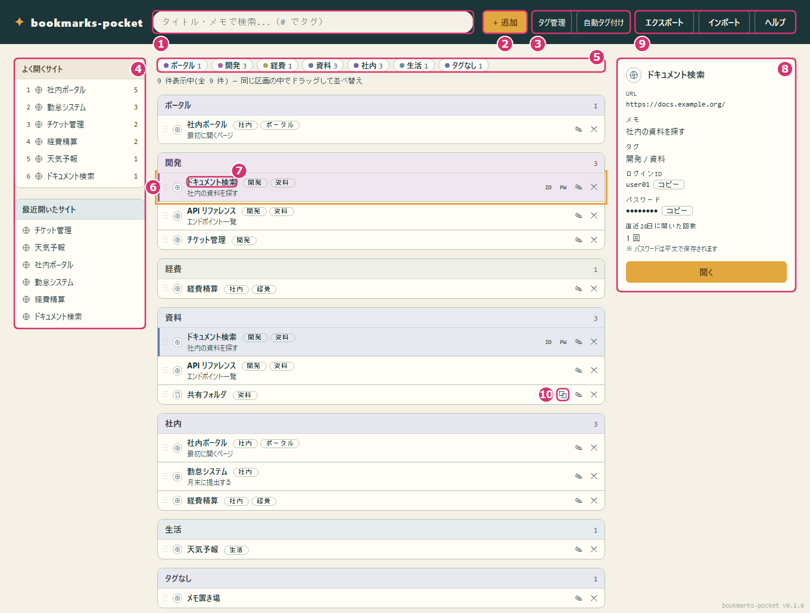

# bookmarks-pocket

ブックマークをタグで管理する、個人用のブラウザアプリです。HTML ファイル 1 つで動き、インストールやサーバーは要りません。

```powershell
git clone https://github.com/asama0101/bookmarks-pocket.git
start bookmarks-pocket\bookmarks.html
```

> **注意: ログインパスワードは暗号化されず、平文で保存されます。** 同じブラウザ・プロファイルを使える人は、開発者ツールで読めます。Chrome・Edge では、同じ PC で開いた別のローカル HTML ファイルからも、保存したデータを読めます。出どころの分からない HTML ファイルは、同じブラウザで開かないでください。共有端末や信頼できない環境では、パスワードを保存しないでください。本ソフトウェアは無保証で、データの消失や漏えいによる損害について、作者は責任を負いません。

## 機能

- ブックマークに複数のタグを付け、タグ名を書いたタイルで絞り込む。空白で区切った語で検索する
- 一覧を、タグごとの区画に分けて表示する。ドラッグ&ドロップで並べ替える
- 直近 28 日によく開いたサイトと、最近開いたサイトを、左列に表示する（このアプリから開いた分だけを数える）
- ログインID・パスワード・メモを保存し、ボタンでコピーする
- `http(s)://`、`file:///`、Windows の UNC パス（`\\server\share\...`）を登録する
- タグの名前変更・削除・色の選択と、複数のブックマークに共通する語からの自動タグ付けをする
- JSON でエクスポート・インポートする

## 導入方法

前提: Windows とモダンブラウザが要ります。動作確認は Windows 11 の Chromium だけで、ブラウザのバージョンは記録していません。Firefox・Safari と、macOS・Linux では未確認です。Git は、clone するときだけ要ります。

1. `bookmarks.html` を入手します。次のどちらかを選びます。
   - Git を使うとき: 作業フォルダで、次のコマンドを実行します。`bookmarks-pocket` フォルダができます。

     ```powershell
     git clone https://github.com/asama0101/bookmarks-pocket.git
     ```

   - Git を使わないとき: [bookmarks.html](https://raw.githubusercontent.com/asama0101/bookmarks-pocket/main/bookmarks.html) を右クリックして、名前を付けて保存します。

2. `bookmarks.html` をブラウザで開きます（ダブルクリック、またはブラウザへドラッグ）。clone した作業フォルダでは、冒頭の `start bookmarks-pocket\bookmarks.html` でも開けます。macOS は `open`、Linux は `xdg-open` を使います（未確認）。

## 使い方

最初に、②「+ 追加」を押して URL とタイトルを入力し、「保存」を押します。タグは、入力して Enter かカンマで確定します（複数付けられます）。URL・タイトル・メモの入力に合わせて、既存のタグ名が自動で選ばれます（外すときは、選ばれたタグの表示を押します）。

保存すると、⑤ にタグ名のタイルが出て、その下に、タグごとの区画が並びます。以降、⑤ のボタンを「タイル」、一覧のタグごとのまとまりを「区画」と呼びます。



図 1: 画面の見かた。次の表の番号は、この図の番号です。

| やること | 操作 | 結果 |
| --- | --- | --- |
| サイトを開く | ⑦ のタイトル、または ④ のサイト名を押す | 新しいタブで開く |
| タグで絞る | ⑤ のタイル、または行のタグを押す | そのタグの区画だけが出る（もう一度押すと全件に戻る） |
| タグのないものを探す | ⑤ の「タグなし」タイルを押す | 最後の「タグなし」の区画だけが出る |
| 検索する | ① に、空白で区切って入力する | すべての語を含むものが出る（× か Esc で解除） |
| 詳細を見る | 行の余白を押す | ⑧ に詳細が出る（ログインID・パスワードは「コピー」） |
| 編集する | 行の右端の鉛筆を押す | その行の位置に、編集フォームが出る |
| 削除する | 行の右端の × を押す | 確認ダイアログのあとに、その行が消える（取り消せない） |
| 並べ替える | ⑥ をドラッグする | 同じ区画の中で、順番が保存される |
| タグを並べ替える | ⑤ のタイルをドラッグする | 並びが保存される |
| タグを整理する | ③「タグ管理」を押す | 名前変更・削除・色の選択・区画の並べ替えができる |
| タグを自動で付ける | ③「自動タグ付け」を押す | 新しいタグの候補と、付け替えの案が出る（置き換わるタグは赤字） |
| `file:///` や UNC のパスを開く | ⑩「パスをコピー」（⧉）を押す | コピーしたパスを、エクスプローラーのアドレス欄などに貼り付けて開く |
| 保存・移行する | ⑨ の「エクスポート」「インポート」を押す | 次の「バックアップと移行」を参照 |
| ショートカットを見る | ⑨ の「ヘルプ」を押す | `/` で検索、Esc で閉じる・解除、と出る |

**注意: 行の削除と、タグ管理での削除・名前変更、「自動タグ付け」での置き換えは、元に戻せません。** タグの削除は、全ブックマークからそのタグを外します。操作の前に、「エクスポート」で保存しておいてください。

補足:

- ④ の「よく開くサイト」は、直近 28 日に開いた回数の上位 10 件です。「最近開いたサイト」は、直近 28 日に最後に開いた新しい順の 10 件です。
- 各ブックマークは、付いているすべてのタグの区画に出ます（重複して出ます）。タグのないものは、最後の区画に出ます。
- 検索の対象は、タイトル・メモ・タグ名です。タグの絞り込みは検索を始めても外れず、両方に合うものが出ます。`#` で始めると、タグを選べます。

### バックアップと移行

データは、ブラウザの localStorage（キー `bookmarks_data`）に保存されます。ブラウザやプロファイルを変えると引き継がれないので、移行やバックアップには⑨ の「エクスポート」を使います。データはこのブラウザの中にしかないので、定期的にエクスポートしてください。

- 「エクスポート」は、全ブックマークと、タグの並び・色を、`bookmarks-export-<日付>.json` として保存します。**ログインパスワードも、平文のまま入ります。** 保存先（クラウド、メール、共有フォルダ）に注意してください。
- **⑨ の「インポート」は、現在のデータを置き換えます。** 確認ダイアログが出ます。戻したいときは、先にエクスポートしておきます。
- URL が不正なエントリは除外されます。除外の件数は、確認ダイアログに出ます。
- 旧版（グループ版）のデータは、開くとグループ名が 1 つのタグになります（グループの並び順は引き継がれません）。新版で保存したデータは、旧版では開けないので、先に旧版でエクスポートしてください。

### 外部への通信

サイトのアイコンは、Google のファビコンサービスから取得します。そのため、登録したサイトのドメイン名が Google に送られます。ドットのないホスト名、IP アドレス、`.local` `.internal` などで終わるホストは送らず、地球儀のアイコンを出します。社内のドメイン名（例: `intranet.example.co.jp`）は見分けられないので、気になるサイトは登録しないでください。

## 困ったとき

### ブックマークがありません。「+ 追加」から登録してください。

保存データが空です。初めて開いたとき、別のブラウザやプロファイルで開いたとき、サイトデータを消去したとき、シークレットウィンドウで開いたとき、`bookmarks.html` を別のフォルダへ移したときに出ます。以前のエクスポートした JSON を「インポート」してください。保存データが壊れていて読めなかったときは、元の内容が localStorage のキー `bookmarks_data_broken` に退避されます（ブラウザの開発者ツールで取り出せます）。

### JSONの読み込みに失敗しました。ファイルの内容を確認してください。

「インポート」で選んだファイルが、JSON として読めません。「エクスポート」で保存した JSON を選び直してください。「インポートするJSONはブックマークの配列か、bookmarks を含むオブジェクトである必要があります。」が出たときも、同じです。

### 確認ダイアログの「URL不正のため N 件は除外」

「インポート」の確認ダイアログに出ます。URL が `http://`、`https://`、`file:///`、UNC パスのいずれでもないエントリは、N 件が除外されて取り込まれません。元の JSON の URL を直してから、もう一度インポートしてください。

### コピーに失敗しました。手動で選択してコピーしてください。

ブラウザが、クリップボードへの書き込みを許可しませんでした。表示されている文字を選択してコピーするか、ブラウザを変えてください。パスワードは、編集フォームの「表示」で見られます。

### `file:///` や UNC のリンクが開かない

ブラウザの制限で、直接開けないことがあります。⑩「パスをコピー」でコピーし、エクスプローラーのアドレス欄などに貼り付けて開いてください。

## ライセンス

[MIT License](LICENSE) です。
